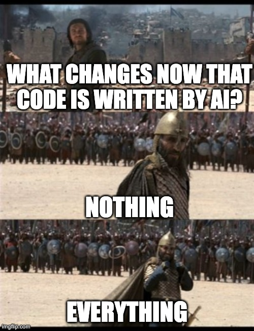

# Testing AI Written Code

vv

## What Changes?

vv

## Nothing

All the same benefits and principles covered before still apply.

vv

## Everything

Now that most/all code, including test code, is being written by AI, the importance of an "objective" means of validating production and test code, is much higher.

vv

# What is New/Different About AI Generated Code? 

vv

# Code is "Cheap"

vv

# Code isn't "Accountable"

vv

# How Do We Make "Cheap" Code "Accountable"?
	
vv

## Three Layers

* Known Knowns - Specifying business requirements in a testable way
* Known Unknowns - Ensure edge cases are covered, guard against biases, and prevent over-fitting 
* Unknown Unknowns - Use long time common practices around static analysis to ensure overall quality of the test suite

