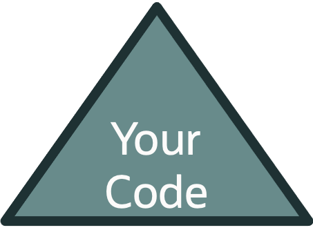
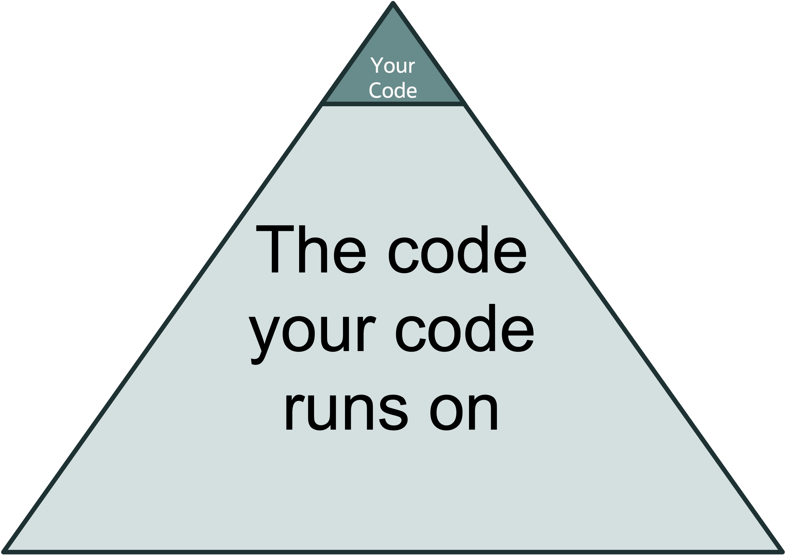

# Why Write (Automated) Tests?

vv

## Not Good "Reasons"

* It's a "best practice"
* Netflix or X "FAANG" company uses automated testing
	* Some general appeal to authority

vv

## Realities of Automated Testing Commitments

* Substantial time and effort to write tests
	* Thinking about test design
		*  Readability
		*  Maintainability
		*  Performance	
	* Ensuring correctness of the tests (The tests are doing what you expect them to do/providing value)

vv	

vv

## Realities of Automated Testing Commitments 

* Substantial time and effort to maintain tests
	* Every code change will require updates to the test suite
		* MAJOR smell if code can change without tests being updated 
	* Substantial changes, might require substantial effort updating the test suite
* Time spent writing and maintaining tests means less time spent writng production code
	*  An hour spent writing/maintaining tests necessarily means an hour _not_ writing new features

vv

# Why Make This Commitment?

vv

# To Provide Confidence 

vv

# To Support an Automated Deployment Process

vv

## Automated Deployment Process Benefits

* Maintain longterm development velocity by reducing the incremental cost of making changes
* Improve the auditability of validating code
* Improve the ease of keeping underlying dependencies up-to-date

vv

## The Dependency Iceberg

vv

## The Dependency Iceberg

vv

## How Many Tests Should I Write?
Whatever gives you the confidence to deploy to production without manual intervention.

vv

## Goodhart's Law

"When a measure becomes a target, it ceases to be a good measure"

[Source](https://en.wikipedia.org/wiki/Goodhart%27s_law)